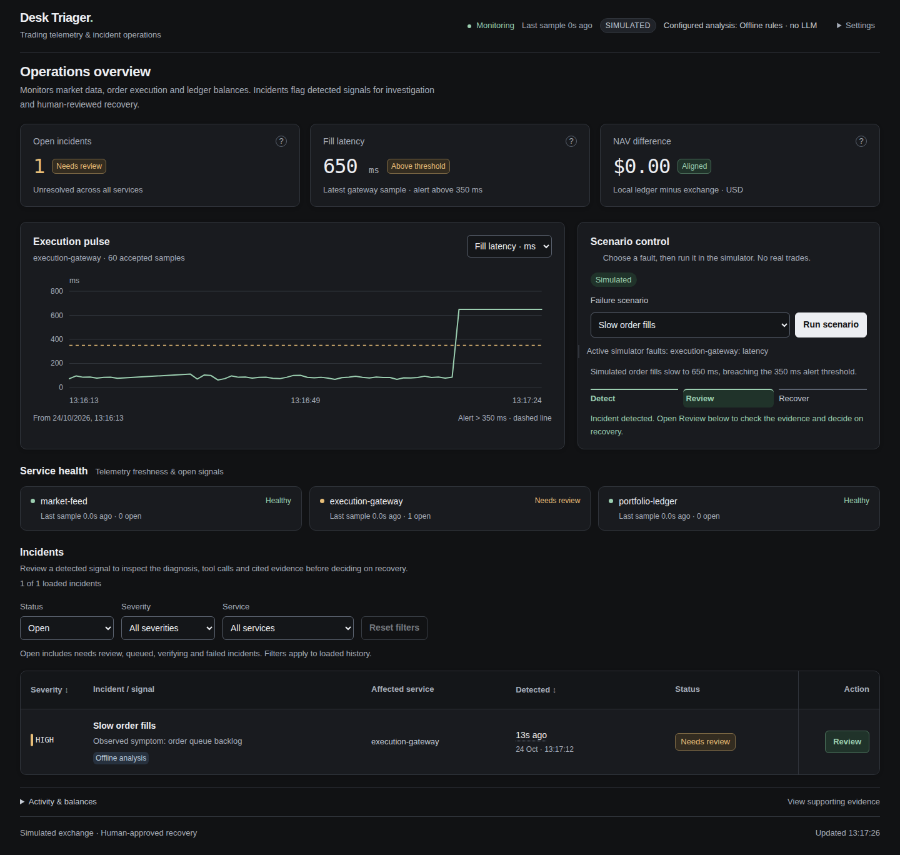
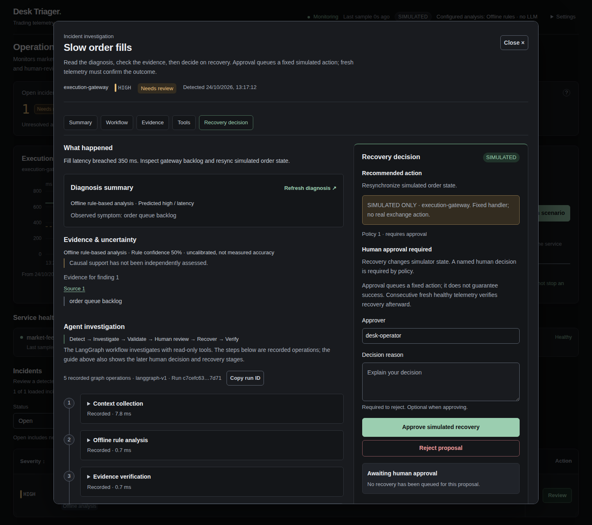
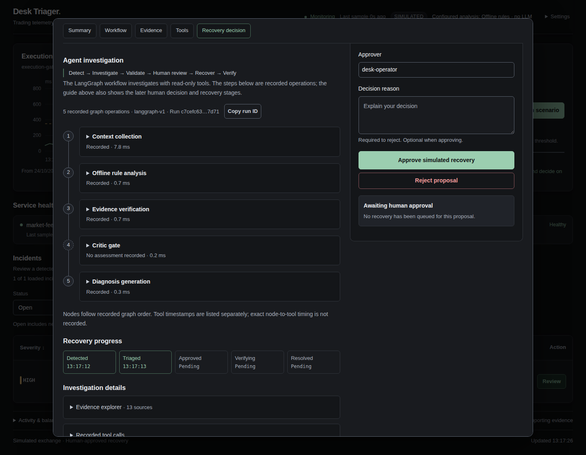
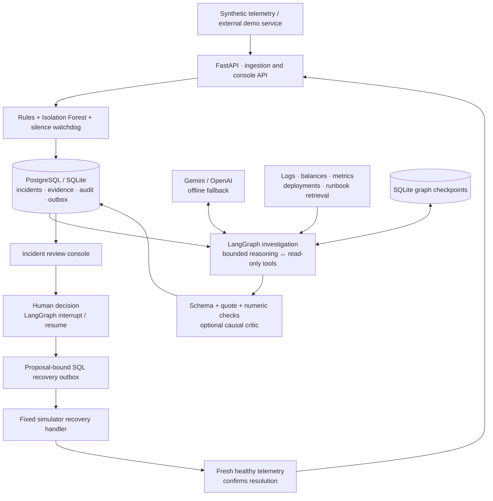

# Desk Triager

**Evidence-backed investigation and human-approved recovery for simulated trading services.**

[](https://github.com/VyankateshD206/desk-triager/actions/workflows/ci.yml)

Desk Triager monitors market data, order execution and ledger balances. When a signal becomes
an incident, a bounded LangGraph workflow gathers evidence, validates its diagnosis and
presents a fixed recovery action for human review. Approval queues recovery; fresh telemetry
must confirm that it worked.

Built with **Python · FastAPI · LangGraph · PostgreSQL / SQLite · pgvector · vanilla JavaScript**.
Optional integrations include **Gemini, OpenAI, Prometheus, Loki and OpenTelemetry**.

[Run locally](#run-locally) · [Architecture](#architecture) · [Measured results](#measured-results) · [Documentation](#documentation)



*Current UI, captured from an isolated SQLite instance with real simulator telemetry and
explicitly labeled offline analysis. Screenshots contain no live exchange data or LLM output.*

## From signal to verified recovery

1. **Detect.** Rules flag stale ticks, slow fills, exchange throttling and NAV discrepancies.
   A receipt-time watchdog catches silent services; an Isolation Forest adds a separate
   anomaly signal.
2. **Investigate.** The agent reads service-scoped logs, balances and metrics. Depending on
   configuration, it can query Loki, Prometheus, deployment records and versioned runbooks.
   Model rounds, tool attempts and investigation time are bounded.
3. **Validate.** Structured output, evidence IDs, exact quotes and numerical references are
   checked independently. Invalid evidence triggers conservative offline analysis. An
   optional critic can assess causal support; literal grounding alone does not prove a cause.
4. **Review.** An operator inspects the diagnosis, uncertainty, recorded tool calls and cited
   sources, then approves or rejects the proposed action. Rejection requires a reason.
5. **Recover and verify.** A proposal-bound, idempotent SQL outbox queues a fixed simulator
   handler. Consecutive fresh healthy samples confirm recovery before the incident resolves.

### Incident review

The review workspace separates investigation from the recovery decision. Provider labels
identify actual offline or model-backed analysis; fallback and missing evidence remain visible.
Expandable panels expose source records, tool arguments, recorded node timings and model usage.



<details>
<summary>Recorded investigation timeline and mobile dashboard</summary>

The timeline follows recorded graph order. A disabled critic is explicitly shown as having
no assessment; node completion is not presented as proof of causal correctness.



[View the full mobile dashboard](docs/media/mobile.png).

</details>

## Run locally

Requires **Python 3.11+**. The default configuration uses SQLite, synthetic telemetry and
rule-based offline analysis. No cloud account, API key or Docker installation is required.

```bash
git clone https://github.com/VyankateshD206/desk-triager.git
cd desk-triager
python3 -m venv .venv
source .venv/bin/activate
pip install -e '.[dev]'
cp -n .env.example .env
make run
```

Open **[localhost:8000](http://127.0.0.1:8000/)**. The console connects automatically;
no desk access token is required. Run a single process/worker: simulation ownership and
rate limits are local to that process.

For a first walkthrough, choose **Slow order fills → Run scenario → Review**. Inspect the
findings and tool records, then approve the simulated recovery. Watch the status move through
**Needs review → Queued → Verifying → Resolved**. Use the **All** status filter to revisit it.
Active faults and retained incident history are shown separately.

| Built-in scenario | Detection signal | Fixed simulated recovery |
| --- | --- | --- |
| Stale market feed | Tick age above 5,000 ms | Reconnect feed |
| Silent feed disconnect | No accepted samples beyond the configured receipt-time limit | Reconnect feed |
| Exchange rate limit | HTTP `429` rejects | Apply retry backoff |
| Slow order fills | Fill latency above 350 ms | Resynchronize order state |
| NAV mismatch | Absolute per-account difference above USD 0.01 | Synchronize ledger |
| Subtle feature drift | Isolation Forest decision margin below zero | Investigation only |

The [Docker demo](docs/RUNBOOKS.md#docker-laboratory) adds PostgreSQL, Prometheus, Loki and a separate fault-injectable
service. Its external fixture demonstrates investigation; the console's recovery handlers
control only the internal simulator.

### Enable model-backed analysis

Set these values in your local `.env`, then restart:

```dotenv
AI_PROVIDER=gemini
GEMINI_API_KEY=YOUR_KEY
GEMINI_MODEL=gemini-3.5-flash-lite
```

Gemini investigations make billable requests. OpenAI is also supported through
`AI_PROVIDER=openai` and `OPENAI_API_KEY`; published live results below use Gemini only.
Provider failures or invalid evidence can produce explicitly labeled offline fallback.

To use PostgreSQL, set `DATABASE_URL` to your connection string. Otherwise, incident storage
stays in local SQLite. Graph checkpoints remain SQLite in both configurations. See
[.env.example](.env.example), [provider configuration](docs/ARCHITECTURE.md#providers-and-observability) and
[retrieval configuration](docs/RETRIEVAL.md). Existing process variables override local files;
`.env.local` takes precedence over `.env`. Keep credentials out of source control.

## Architecture



The investigation graph is read-only. Recovery authorization lives in a separate deterministic
workflow, independent of model text. SQL is authoritative for proposals, decisions and job
idempotency; checkpointing records graph progress. Python background workers handle ingestion,
watchdog checks, triage and recovery without a message broker.

[Architecture and tradeoffs](docs/ARCHITECTURE.md) · [Agent workflow](docs/ARCHITECTURE.md#agent-workflow) · [Recovery guarantees](docs/ARCHITECTURE.md#recovery)

## Measured results

The versioned benchmark has **40 cases**: 20 demo-fault variants, ten public-postmortem-inspired
reconstructions and ten ambiguous cases. Related incident families stay within one split:
25 development cases and 15 test cases. Labels are **agent-authored and await human review**;
these scores are provisional, not independently validated diagnosis accuracy.

Gemini run, `gemini-3.5-flash-lite`, 40 attempts per mode:

| Mode | Severity accuracy | Category macro F1 | Error / fallback | Median latency |
| --- | ---: | ---: | ---: | ---: |
| Offline rules | 62.5% | 0.296 | 0% | — |
| One prompt | 72.5% | 0.448 | 15% | 6.49 s |
| LangGraph | 80.0% | 0.433 | 10% | 12.02 s |
| LangGraph + retrieval | 77.5% | 0.429 | 20% | 13.56 s |

All-attempt scores include conservative fallback. Latency includes pacing and retries.
The archived test-split category accuracy is **53.3% for both graph modes**; this establishes
no RAG benefit. These runs predate query-aware retrieval. Seven authored search queries also
cannot establish improved diagnosis accuracy or a semantic-vector advantage.

The new evaluation workflow supports reviewed labels, partially blinded diagnosis review,
paired comparisons, family-cluster bootstrap intervals, actual retrieval-use tracking and
latency/cost coverage. Pending human judgments stay unscored. Complete billed costs remain
unknown when usage is missing.

```bash
# Offline regression and review preparation; no model requests
make eval
python -m evals.review_packets labels --output /tmp/label-review.json
```

[Full results, cost estimates and caveats](docs/EVALUATION.md#historical-gemini-results) · [Paired evaluation procedure](docs/EVALUATION.md#incident-benchmark) ·
[Human review rubric](docs/EVALUATION.md#human-review-rubric) · [Raw versioned reports](evals/results/v1.7.0/)

## Development

```bash
make test    # Python regression suite with mocked model providers
make build   # Lint, frontend behavior checks, wheel build and asset verification
make eval    # Offline incident, security and detection evaluations
```

Node.js enables frontend checks; the application itself has no npm build or frontend framework.
GitHub Actions runs tests, offline evaluation and Docker evidence/recovery integration without
cloud credentials. See [CONTRIBUTING.md](CONTRIBUTING.md) for development conventions.

## Scope and limitations

This is a single-process incident-response application for a **simulated trading desk**.
It does not place real orders or execute model-generated commands. The local API has no
multi-user authentication or RBAC; approver names are attribution labels. Keep the local
configuration bound to localhost.

Evidence validation proves reference/extract consistency, not causal truth. Confidence is
uncalibrated; the optional critic is fallible. Hashed vectors are a lexical retrieval baseline.
The public NAB experiment evaluates an adapted scalar detector, not production trading
accuracy. Distributed worker ownership, coordinated rate limits, production identity and
real exchange adapters are outside the current scope.

## Documentation

| Guide | Purpose |
| --- | --- |
| [Architecture](docs/ARCHITECTURE.md) | Components, agent workflow, approval guarantees, providers and traces |
| [Runbooks](docs/RUNBOOKS.md) | Incident response, troubleshooting and the instrumented Docker laboratory |
| [Retrieval](docs/RETRIEVAL.md) | Query validation, knowledge versions and vector backends |
| [Evaluation](docs/EVALUATION.md) | Benchmarks, measured results, label review and detection experiments |
| [Security](docs/SECURITY.md) | Evidence validation, tool restrictions and recovery trust boundaries |

The incident-agent direction was inspired by
[auto-triage-agent](https://github.com/kh-arash/auto-triage-agent); Desk Triager develops it
for trading telemetry with bounded tools, explicit evidence checks and durable human approval.
