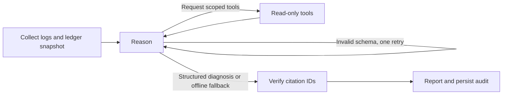

# LangGraph investigation (v1.2.0)

The production path now calls `StateGraph`, not a manually coded provider loop. Gemini
can request service metrics when initial evidence is insufficient. Logs and balance
snapshots are collected first; tools already collected are not executed again. Unknown
tools and nonempty arguments receive errors. No node executes recovery actions.

## Contracts and budgets

Provider output must validate as `Diagnosis`, including bounded finite confidence,
explicit abstention reasons, and cited hypotheses. A malformed response gets one repair
attempt within the same total round budget. Invalid evidence references or extracts replace the model diagnosis with the offline
symptom baseline. Since v1.4.0, each cited ID also needs a verified quote or structured
numeric claim. Semantic support and causal correctness are not established by these checks.
See [security boundaries](SECURITY.md).

Default settings allow four model rounds, eight total tool attempts (including the two
initial reads), and a 60-second investigation deadline. Duplicate and rejected attempts
consume the tool budget. Each HTTP call has at most a 20-second timeout, reduced to the
remaining deadline. Budget exhaustion returns an abstention. These limits do not cancel
an in-flight database call; database timeouts remain a separate concern.

The offline baseline classifies known symptom phrases and abstains on unrecognized input.
It is not a root-cause model. Neither provider receives the runtime's predefined diagnosis,
incident kind, or proposed recovery action as an answer hint.

## Persistence

Each diagnosis creates a new UUID run. SQLite checkpoints store evidence and model
conversation at graph node boundaries. The run ID, workflow name, and structured diagnosis
are retained in the incident audit. A manual retriage creates a fresh run rather than
overwriting an old conversation.

`TriageAgent.resume(run_id)` resumes a failed or interrupted read-only investigation.
Completed security-versioned runs return their stored result. Runs created before the
v1.4.0 redaction boundary require a fresh diagnosis. Original deadlines remain in force after
restart. There is no public resume endpoint yet; existing authenticated triage endpoints
start fresh investigations.

For a local SQLite database, the default checkpoint file is `<database>.graph.sqlite3`.
For PostgreSQL or an in-memory database it is `./triage-checkpoints.sqlite3`. Override
with `GRAPH_CHECKPOINT_PATH`. The checkpoint file contains incident data; protect and
back it up alongside application data. Checkpoint files are excluded from Git.

This remains a single-process application. PostgreSQL incident storage does not make
local graph checkpoints distributed. Checkpoint pruning, PostgreSQL checkpointers,
distributed work claiming, and automatic restart discovery remain follow-up work.

## Recovery boundary

Existing deterministic action selection, human approval, and fresh-telemetry recovery
verification remain authoritative. Graph checkpoint resume cannot approve an action.
Native human approval interrupts, proposal version binding, and a durable execution outbox
are planned separately. This release tests interruption after evidence collection to prove
that a new agent instance resumes without repeating those reads.

## Validation

Regression tests exercise extra evidence collection, unknown tools, forbidden arguments,
duplicate reads, global tool limits, round limits, expired deadlines, schema repair,
fabricated citations, credential-safe error reporting, and restart/resume behavior.
Provider calls are mocked; this release does not claim live model accuracy or benchmark
improvements. The offline seed evaluation remains available with `python -m evals.run`.
