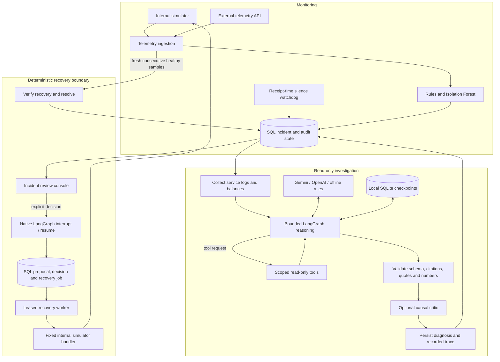

# Architecture

Desk Triager has one FastAPI process, Python background workers and SQL-backed incident
state. The browser is a static HTML/CSS/JavaScript client. The default local configuration
uses SQLite and synthetic telemetry; PostgreSQL and external evidence sources are optional.

## Components and data flow

The diagram summarizes component relationships, not an exact execution trace. In particular,
checkpointing occurs at graph node boundaries; node/tool correlation is limited to recorded
metadata. The optional critic gate can execute without a model assessment. See
[the agent workflow](ARCHITECTURE.md#agent-workflow) for actual node routing and fallback behavior.

## Storage and ownership

- SQL stores telemetry, watermarks, balances, incidents, proposals, recovery jobs and audit
  records. SQLite is the default; `DATABASE_URL` selects PostgreSQL. Money remains in the
  existing decimal string representation, with Decimal-based reconciliation and validation.
- Graph checkpoints use SQLite even when incident storage is PostgreSQL. They preserve
  investigation and approval progress; they do not replace SQL execution authorization.
- Runbook retrieval uses pgvector with PostgreSQL or local vectors with SQLite. The default
  embedding is a local lexical hash; Gemini semantic embeddings require explicit configuration.
- One process owns simulation, ingestion and workers. A reentrant process lock is not a
  distributed lock. Run one worker; PostgreSQL alone does not make scale-out safe.

## Consistency and recovery

Ingestion inserts telemetry, advances accepted service watermarks and creates or updates
incidents transactionally. Event IDs deduplicate repeated submissions. Old or out-of-order
samples can be archived but cannot refresh service health or verify recovery. Receipt-time
silence detection uses a startup grace period and does not depend on a faulty event clock.

Unresolved service/signal pairs reuse an incident. Temporally adjacent silence incidents
can share a display group, but their IDs and recovery decisions stay independent: time
proximity does not establish a common cause.

Human decisions bind to the reviewed proposal. SQL authorizes and deduplicates recovery,
including crash/replay cases where SQL commits before a checkpoint update. Approval queues
work; it is not a resolution event. Consecutive fresh healthy samples after approval confirm
the outcome, subject to verification deadlines. See [recovery guarantees](ARCHITECTURE.md#recovery).

Direct ingestion has no durable buffer before SQL commit. A database outage can lose samples
that were not committed. Worker errors and receipt-time gaps expose this failure mode.

## Evidence and provider boundaries

The investigation receives service-scoped, sanitized evidence, not the detector's predefined
answer or proposed action. Tools cannot execute recovery or accept arbitrary SQL, shell,
URLs, LogQL or PromQL. Runbook search accepts a validated query while service, search method
and result limits remain application-controlled.

The verifier checks evidence IDs, literal quotes and exact numeric claims. Strict decimal
strings are accepted only for allowlisted ledger fields and sources. These checks establish
extract consistency, not semantic entailment or causal truth. Invalid evidence triggers a
conservative offline report; exhausted investigation budgets produce abstention. Optional
critic output remains fallible and cannot authorize an action.

Provider adapters use REST without an AI provider SDK. Recorded call metadata supplies usage
and estimated costs where available. Optional OTLP spans exclude evidence/exception text;
redacted SQL and checkpoint evidence still needs an operator-defined retention policy.

## Interface and deployment

Read-only dashboard queries do not hold the ingestion lock across network round trips.
Full-database counts remain independent of bounded history loaded by the console. Review
opens immediately, disables decisions while its proposal loads, and ignores stale responses.
Timestamps use the browser's locale and timezone.

The local API has no user authentication or RBAC. Approver names are attribution labels.
In-process rate limits, simulator ownership and checkpoint storage assume a single process.
The current application is a localhost simulated desk, not a production exchange gateway.
Distributed work claiming, coordinated limits, multi-user identity and real exchange
execution adapters are deliberately outside its scope.

The optional [Docker laboratory](RUNBOOKS.md#docker-laboratory) supplies PostgreSQL, Prometheus, Loki and a separate
fault app. External tools inspect that app; internal simulator handlers cannot recover it.
Fault injection/reset uses the demo service's separate control API.

## Agent workflow

The production path uses `StateGraph`. Gemini or OpenAI can request scoped evidence when
the initial logs and balance snapshot are insufficient. Tools already collected are not
executed again. Unknown tools and unexpected arguments receive errors. Runbook search is
the only tool accepting arguments: a validated incident-specific `query`, with service,
vector method and top-three limit fixed by the application. All other tools are
argument-free. No investigation node executes recovery actions.

### Contracts and budgets

Provider output must validate as `Diagnosis`, including bounded finite confidence,
explicit abstention reasons, and cited hypotheses. A malformed response gets one repair
attempt within the same total round budget. Invalid evidence references or extracts replace the model diagnosis with the offline
symptom baseline. Since v1.4.0, each cited ID also needs a verified quote or structured
numeric claim. Semantic support and causal correctness are not established by these checks.
See [security boundaries](SECURITY.md).

Default settings allow four model rounds, eight total tool attempts (including the two
initial reads), and a 60-second investigation deadline. Duplicate and rejected attempts
consume the tool budget. Each HTTP call has at most a 20-second timeout, reduced to the
remaining deadline. Budget exhaustion returns an abstention. These limits do not cancel
an in-flight database call; database timeouts remain a separate concern.

The offline baseline classifies known symptom phrases and abstains on unrecognized input.
It is not a root-cause model. Neither provider receives the runtime's predefined diagnosis,
incident kind, or proposed recovery action as an answer hint.

### Persistence

Each diagnosis creates a new UUID run. SQLite checkpoints store evidence and model
conversation at graph node boundaries. The run ID, workflow name, and structured diagnosis
are retained in the incident audit. A manual retriage creates a fresh run rather than
overwriting an old conversation.

`TriageAgent.resume(run_id)` resumes a failed or interrupted read-only investigation.
Completed security-versioned runs return their stored result. Runs created before the
v1.4.0 redaction boundary require a fresh diagnosis. Original deadlines remain in force after
restart. There is no public resume endpoint yet; existing triage endpoints
start fresh investigations.

For a local SQLite database, the default checkpoint file is `<database>.graph.sqlite3`.
For PostgreSQL or an in-memory database it is `./triage-checkpoints.sqlite3`. Override
with `GRAPH_CHECKPOINT_PATH`. The checkpoint file contains incident data; protect and
back it up alongside application data. Checkpoint files are excluded from Git.

This remains a single-process application. PostgreSQL incident storage does not make
local graph checkpoints distributed. Checkpoint pruning, PostgreSQL checkpointers,
distributed work claiming, and automatic restart discovery remain follow-up work.

### Recovery boundary

Existing deterministic action selection, human approval, and fresh-telemetry recovery
verification remain authoritative. Graph checkpoint resume cannot approve an action.
Version 1.5.0 implements native human approval interrupts, proposal binding, and a SQL
execution outbox in a separate deterministic recovery graph; see [recovery](ARCHITECTURE.md#recovery). This release tests interruption after evidence collection to prove
that a new agent instance resumes without repeating those reads.

### Validation

Regression tests exercise extra evidence collection, unknown tools, forbidden arguments,
duplicate reads, global tool limits, round limits, expired deadlines, schema repair,
fabricated citations, credential-safe error reporting, and restart/resume behavior.
Regression provider calls are mocked. Historical live Gemini measurements and their limits
are documented in [results](EVALUATION.md#historical-gemini-results); they establish no broad diagnosis or retrieval
advantage. The offline seed evaluation remains available with `python -m evals.run`.

## Recovery

Recovery uses a dedicated deterministic LangGraph workflow linked to the diagnosis run.
It pauses at `interrupt()` with a persisted, fingerprinted proposal. The explicit human
approval or rejection endpoint resumes that interrupt with `Command(resume=...)`.
No model can call these endpoints through the investigation graph.

The proposal binds incident ID, service, action, policy, report hash, diagnosis run ID,
simulator fault generation, and ledger preconditions. Updated diagnosis runs, faults,
balances, or policy require another review. Evidence continues to arrive while review is
pending; the proposal describes a frozen recovery intent rather than every later log line.

Approval requests require `proposal_id`, `action`, `actor`, and an `Idempotency-Key` header
of 8–80 characters. Reusing a key with an identical request returns its existing execution;
reusing it with another request is rejected. A second key cannot approve the same proposal.
Keys are hashed in SQL. Rejection requires a reason and is persisted but never executed.
Refreshing diagnosis creates a new proposal even when report text remains the same.

Approval and a queued outbox job commit together in application SQL. Graph checkpoint and
SQL writes are separate; replay consults SQL uniqueness and request hashes to avoid a second
job. A pending SQL proposal whose interrupt was not written is reconstructed on demand.
A background worker discovers queued jobs on startup, atomically claims one with a lease,
rechecks policy and preconditions, and executes a fixed simulation handler. Expired leases
can be reclaimed; transient failures retry at most three times, while changed preconditions
fail immediately. No external exchange execution adapter is installed.

Ledger changes, durable fault removal, job completion, and action audit commit in the same
SQL transaction. Simulator faults are now persisted; a newly injected generation cannot be
cleared by an older approval. The running simulator refreshes its fault state from SQL.
This provides transactional execution for these SQL-backed simulation handlers, not an
exactly-once guarantee for arbitrary external side effects.

Incidents move `open → queued → verifying → resolved`. Execution failures or verification
timeouts move to `failed` for operator attention. Two consecutive fresh healthy samples are
required by default; an unhealthy accepted sample resets progress. The default deadline is
30 seconds. Legacy verifying rows without a durable job retain compatibility behavior.
Original receipt-time, watermark, and late-sample protections remain in force.

The console shows queued/failed states, supports rejection feedback, and retains an
idempotency key per proposal in session storage for request retries. The actor is an
attribution label, not verified identity. No desk access token is required. Application ingestion and
simulation remain single-process even though SQL jobs use atomic claims.

Regression tests cover native interrupts, restart/resume, concurrent identical requests,
key misuse, stale proposals, rejection, worker leases, SQL commit replay, verification
windows, and timeouts. CI additionally exercises PostgreSQL ledger execution and competing
worker claims in an isolated temporary schema. Feedback counts and approval rate are
available in `/api/snapshot`; rejected examples are not automatically trusted as knowledge.

### Reusing feedback

`python -m evals.feedback --output /tmp/feedback-candidates.json` exports rejected diagnoses
and their redacted evidence as unlabeled candidates. Actor names are excluded. A rejection
is not a root-cause label: review the evidence, supply a corrected answer, and assign the
incident family to one split before adding it to the benchmark. Knowledge imports still
require a separate reviewed knowledge document; feedback is never indexed automatically.
The console reports approvals, rejections and approval rate from durable decision records.

## Providers and observability

Set `AI_PROVIDER=gemini` to use the configured Gemini REST model. The OpenAI Responses
adapter accepts `AI_PROVIDER=openai`, `OPENAI_MODEL` and `OPENAI_API_KEY`; its tool history
and fallback behavior are mock-tested. This release publishes Gemini live measurements
only. `FALLBACK_PROVIDER=offline` is the default; opting into another provider can transmit
the same redacted incident context to that provider and incur additional charges.

A provider call has a maximum 20-second timeout and at most one retry for transport errors,
429, or selected 5xx responses. Both attempts share the investigation deadline. Invalid
schema output gets one graph repair attempt; tool/round/deadline budgets remain enforced.
A failed provider falls back to a conservative symptom report. The console and evaluation
report retain that fact; a fallback result must not count as successful model reasoning.

`CRITIC_ENABLED=true` enables a second model pass after extract validation. Set
`CRITIC_PROVIDER=gemini` or `openai` to choose the critic; empty uses the primary provider.
The critic assesses every hypothesis exactly once, drops unsupported hypotheses and
abstains when no supported hypothesis remains. An unavailable requested critic causes
abstention. Its opinion is fallible and does not authorize recovery. The default remains
o critic so the retrieval ablation does not change two variables simultaneously.

Every completed investigation retains node durations, input/output token usage where
reported by the provider, and dated standard text cost estimates. Pricing provenance lives
in `triager/knowledge/pricing.json`. Missing usage, failed request attempts, unavailable
critics or semantic embedding charges make total cost unknown; unknown is not zero.
Estimates exclude discounts, taxes and provider billing adjustments. Model thought tokens
are included in Gemini output usage when reported. Node traces are available in the incident
review and persisted SQL audit.

Set `OTEL_EXPORTER_OTLP_ENDPOINT` for an optional OTLP HTTP collector. Spans contain the
service, run ID, node timings and usage estimates. Evidence and exception text are excluded
from span attributes. SQL audit/checkpoint data still contains redacted diagnostic evidence;
restrict access and define retention for your deployment. The collector is operator-provided.

The local API has per-client-IP in-process limits: 600 requests/minute generally
and six manual triage requests/minute. HTTP 429 includes Retry-After. Forwarded headers
are not trusted. These limits, simulator ownership and worker lifecycle assume one process;
scale-out needs coordinated limits and ingestion ownership. The approver name is an
operator attribution label, not an authenticated multi-user identity.

### Per-tool audit records

Each collected or rejected tool invocation has its actual arguments, service scope, timestamp,
status, latency, up to 600 redacted result-preview characters and evidence IDs in `tool_events`.
The checkpoint and SQL diagnosis audit retain these records. Raw tool output remains in the
sanitized evidence payload. The UI uses text rendering for previews and flags unsupported
extracts. Model planning tokens are recorded on reasoning calls, not attributed to HTTP/SQL
tools that consume no model tokens. Failed and duplicate requests remain visible.
