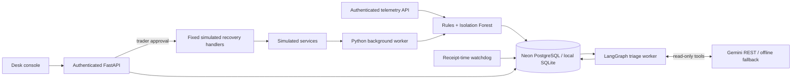

# Architecture

One Python process owns simulation, ingestion, detection, and recovery. SQL is the source of truth. No separate infrastructure is required beyond the optional Neon database and Gemini API connection.

## Consistency

- Ingestion inserts the event, updates service watermarks, and creates/updates incidents in a SQL transaction. Event IDs are primary keys, making duplicate submissions idempotent.
- A reentrant process lock serializes ingestion, fault injection, and approvals. It is not a distributed lock; run one worker.
- The watchdog uses monotonic receipt time to detect total silence. Startup grants a grace period. Old or out-of-order events are archived but cannot refresh service health or verify recovery. Accepted timestamps are persisted in `service_watermarks`.
- Unresolved `(service, kind)` pairs reuse an incident. An incident does not close just because telemetry improves. Approval must be followed by a fresh, healthy sample whose timestamp is later than the approval.
- Recovery audit entries and ledger updates share a transaction. Simulator fault generations, incidents, recovery jobs, and audit history survive restart.
- Direct ingestion has no durable buffer before SQL commit. During a database outage, samples that could not be committed can be lost; worker errors and receipt-time gaps make this visible.

## Diagnosis

A background worker handles one undiagnosed open incident at a time. It stores the report, so repeated anomalous samples do not create more model calls. Manual refresh is explicit. Gemini can request only scoped log reads and a fixed balance reconciliation query. A bounded LangGraph loop preserves model response parts for function-call continuity. Each
node checkpoints to a local SQLite file. Provider failures return offline symptom analysis;
budget exhaustion returns an abstention. The model receives service-scoped evidence, not the
detector's predefined diagnosis or action. See [workflow limits](AGENT_WORKFLOW.md).

## Interface

The main view contains three metrics, one latency chart, guided scenario controls, compact service health, and an incident table. Explanations appear on hover, keyboard focus, or tap. Per-sample chart tooltips show timestamps, units, and the alert threshold. Settings, ledger balances, audit history, raw evidence, and recovery code are progressively disclosed.

Read-only dashboard queries do not hold the ingestion lock across network round trips. Unresolved counts are grouped in one SQL query, and reconciliation reuses the active session. The metric and service totals are full-database queries, independent of the bounded incident history shown in the console. Timestamps use the browser's locale/timezone.

## Model limits

The model uses a frozen synthetic healthy baseline and fitted feature scaling. The decision margin is not a probability. Before real desk use, evaluate historical data chronologically, measure false alarms per service-hour, calibrate service-specific thresholds, and version the dataset and model together. An autoencoder is intentionally not added alongside an unvalidated Isolation Forest.

## Instrumented Docker demo

The optional [Compose laboratory](DEMO.md) runs the same triager with external telemetry
and the internal simulator disabled. A separate execution-service fixture generates faults,
pushes logs to Loki, and exposes gauges scraped by Prometheus. The graph can query those
sources and the fixture's deployment registry through fixed read-only tools. Incident SQL
uses PostgreSQL; graph checkpoints remain local SQLite on a named volume.

This diagnostic stack intentionally has no adapter for executing recovery in the external
fixture. Its fault/reset controls are separate from the triager's approval API. Model-driven recovery remains disabled. The internal simulator now uses native approval
interrupts and a transactional execution outbox; see [recovery](RECOVERY.md).
